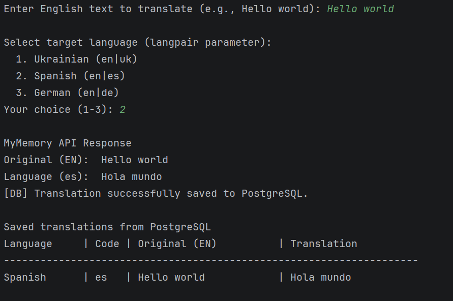
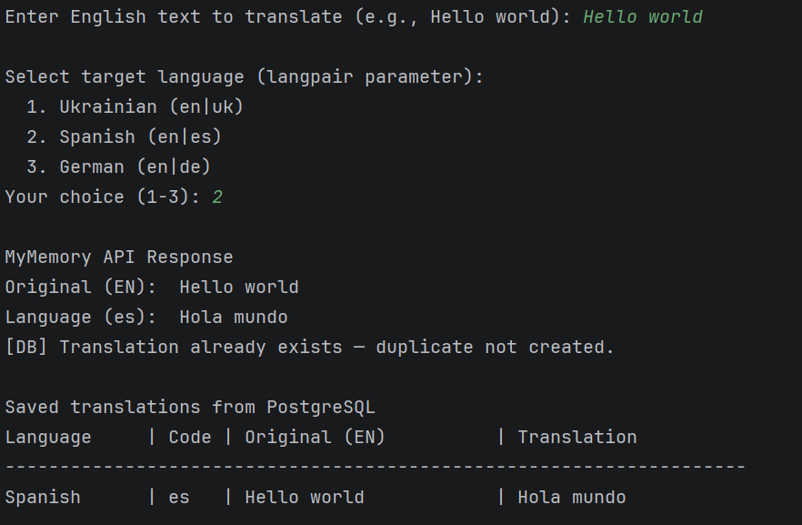
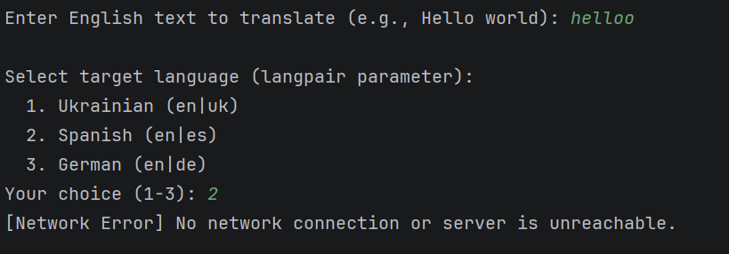

# MyMemory Translator (Python + PostgreSQL)

Console application in Python that translates text using the **MyMemory Translation API**, stores the results in a **PostgreSQL** database, and displays saved records.

## Used API
- **Name:** [MyMemory Translation API](https://mymemory.translated.net/doc/spec.php)
- **Endpoint:** `GET [https://api.mymemory.translated.net/get](https://api.mymemory.translated.net/get)`
- **Query parameters that change the response:**
  - `q` — source English text to translate
  - `langpair` — language pair (e.g., `en|uk`, `en|es`, `en|de`)

## Database Schema (PostgreSQL)
The project uses 2 related tables:
1. `languages` (`id`, `code`, `name`) — lookup table for target languages (`UNIQUE(code)`).
2. `translations` (`id`, `language_id`, `source_text`, `translated_text`, `created_at`) — stores translations with a foreign key `language_id REFERENCES languages(id)` and a `UNIQUE (language_id, source_text)` constraint to prevent duplicate entries.

## Setup & Run Instructions

1. **Create a PostgreSQL database:**
   ```sql
   CREATE DATABASE translator_db;
   ```

2. **Clone the repository:**
   ```bash
   git clone <your-repo-url>
   cd mymemory-translator
   ```

3. **Create and activate a virtual environment:**
   ```bash
   python -m venv .venv
   .venv\Scripts\activate
   ```

4. **Install dependencies:**
   ```bash
   pip install -r requirements.txt
   ```

5. **Configure environment variables:**
   Copy `.env.example` to `.env` and set your PostgreSQL credentials:
   ```bash
   copy .env.example .env
   ```

6. **Run the application:**
   ```bash
   python main.py
   ```

## Screenshots

### 1. API Request, Saving to PostgreSQL & Displaying Data


### 2. Duplicate Prevention & Different Language Parameter


### 3. Error Handling (Network Error)

